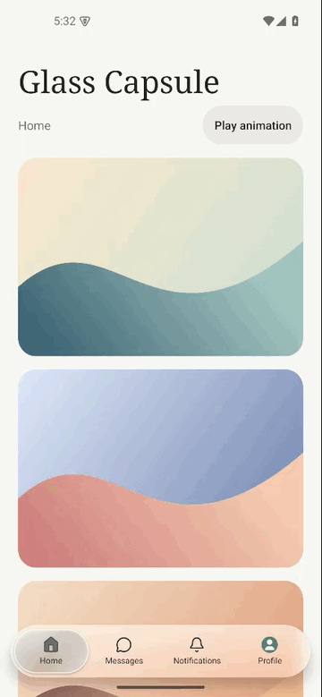

# Glass Capsule Nav for Android

A floating navigation bar for Android Views. It blurs scrolling content behind it and slides a fixed-width selection capsule between equally spaced tabs. Built-in icons scale and transition between outline and translucent fill.

<picture>
    <source media="(prefers-reduced-motion: reduce)" srcset="docs/demo.png">
    
</picture>

## Run the demo

Use JDK 17 and Android SDK 36. The library and demo target devices running Android 11 (API 30) or later.

```sh
./gradlew :demo:installDebug
```

Open **Glass Capsule** and tap **Play animation** to cycle through its four tabs. Use **Stop animation** or tap a tab to take over. You can scroll the color panels to see the blur update behind the bar. To build the library AAR locally, run `./gradlew :library:assembleRelease`.

## Add it to an Android Views project

Include the [library module](library/) and add `implementation project(":library")` in the app module. The [sample Gradle settings](settings.gradle) show the repositories required to resolve BlurView.

Place the bar above a view group that draws the page content. Keep them as siblings in the same window. Allow their parent to draw outside child bounds with `android:clipChildren="false"` so the shadow can spread. Inside `GlassNavBar`, put the tabs in a horizontal `LinearLayout` with ID `@id/glass_nav_tabs` and use the included styles. See the [complete XML layout](demo/src/main/res/layout/activity_demo.xml).

```java
GlassNavBar bar = findViewById(R.id.glass_bar);
GlassNavTab home = findViewById(R.id.tab_home);
GlassNavTab notifications = findViewById(R.id.tab_notifications);

bar.setBackdrop(findViewById(R.id.backdrop), null);
bar.selectTab(home, false);
notifications.setOnClickListener(view -> {
    // Switch the page in your own navigation code.
    bar.selectTab(notifications, true);
});
```

### Configure titles and icons in XML

```xml
<io.github.bohaofu.glasscapsulenav.GlassNavTab
    android:id="@+id/tab_profile"
    style="@style/Widget.GlassCapsuleNav.Tab"
    app:glassNavLabel="@string/profile"
    app:glassNavIcon="profile"
    app:glassNavDrawable="@drawable/ic_demo_avatar" />
```

- Set the title and accessibility label with `glassNavLabel`. Define a string resource to localize the label.
- Set `glassNavIcon` to `home`, `message`, `add`, `notification`, or `profile` for an outline-to-fill glyph. Set `glassNavDrawable` to a drawable resource for a custom image with the same scale animation. If supplied, the drawable takes precedence over the built-in glyph.
- Set click handlers on each tab. For standalone actions such as **Add**, keep the current selection by leaving `selectTab` out of that action's handler.
- Light and dark palettes follow Android's resource configuration. Selection animation respects the system animator setting.

## 中文说明

这是一个原生 Android Views 玻璃底栏组件，包含实时背景模糊、固定宽度的滑动胶囊、图标缩放与镂空填充。用 `./gradlew :demo:installDebug` 安装示例，点 **Play animation** 即可观看四个 Tab 的切换动画。每个 Tab 的标题、内置图标或自定义图片均可在布局 XML 中配置。

## License

Project code is available under the [MIT License](LICENSE). The [Lucide icon notices](library/src/main/assets/licenses/lucide.txt) are bundled with the library. The live blur uses [BlurView](https://github.com/Dimezis/BlurView/tree/version-2.0.6), distributed under [Apache 2.0](https://github.com/Dimezis/BlurView/blob/version-2.0.6/LICENSE.md).
